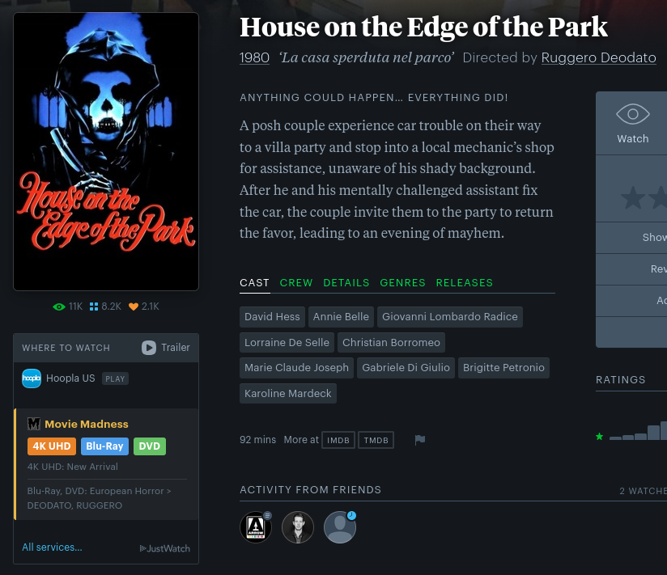

# Movie Madness Availability for Letterboxd

Long live physical media!

Movie Madness is an independent video store and nonprofit film museum in Portland, Oregon. This script adds [Movie Madness](https://www.moviemadness.org) rental availability to [Letterboxd](https://letterboxd.com) film pages. 

When you're browsing a film on Letterboxd, the script checks the Movie Madness collection and shows which formats are available to rent and which shelf they're on — with a direct link to the search results.

## Installation

1. Install a userscript manager for your browser:
   - [Tampermonkey](https://www.tampermonkey.net/) (Chrome, Firefox, Safari, Edge) — recommended
   - [Greasemonkey](https://www.greasespot.net/) (Firefox)
   - [Violentmonkey](https://violentmonkey.github.io/) (Chrome, Firefox)

2. Click this link to install the script: **[moviemadness-letterboxd.user.js](https://github.com/tjsander/mmboxmonkey/raw/main/moviemadness-letterboxd.user.js)**

   Or install manually: open your userscript manager dashboard, create a new script, and paste in the contents of `moviemadness-letterboxd.user.js`.

3. Navigate to any film page on Letterboxd (e.g. `letterboxd.com/film/hellraiser/`), or a member's review or diary entry for a film. The widget appears in the "Where to Watch" panel.

## How it works

On each Letterboxd film page the script first reads the film's TMDB id from the page's link to TMDB and looks it up in a [daily list of Movie Madness rentals by TMDB id](https://github.com/tjsander/movie-madness-pdx-tmdb). That is one small request to GitHub Pages, with nothing to match: the widget shows the formats held (`4K UHD`, `Blu-Ray 3D`, `Blu-Ray`, `DVD`, `DVD-R`, `VHS`) and the shelf they're on, and each badge links to a search for that rental under the store's own title. When editions are shelved apart, each shelf is listed with its formats. Review and diary pages carry no TMDB id, so there the script reads it from the film's own Letterboxd page first.

The widget appears as soon as there is an answer, without waiting for Letterboxd's streaming list, and moves under that list if one loads.

The list is rebuilt once a day and covers about three quarters of the store's rentals. When it has nothing for a film or can't be reached, the script searches the store instead, showing a turning film reel in the widget until the search finishes:

1. Reads the film title, year, and director credits from the page's Open Graph metadata and crew links.
2. Fetches `moviemadness.org/search/?query=<title>` via `GM_xmlhttpRequest`, bypassing CORS restrictions. Movie Madness returns 12 results per page, best title matches first, so the script keeps requesting the next page (`&offset=12`, `24`, …) while a page still contains title matches, up to five pages.
3. Parses the server-rendered HTML into individual catalog entries, keeps the ones whose title, year, and director match the film you're viewing, then extracts format labels (`4K UHD`, `Blu-Ray`, `DVD`, `VHS`).
4. Shows the formats it found as colored badges, each linking to the Movie Madness search results, or "Not found in collection". If the store can't be reached, the widget links to the search instead.

Everything below describes that search.

Title matching handles common variations between the two sites — articles moved to the end (`GODFATHER, THE`), edition suffixes (`(UNRATED)`, `(ARROW)`), inconsistent Blu-Ray spellings (`BLU RAY` vs `BLU-RAY`), and sequel numbers Movie Madness adds ahead of a subtitle (`JAWS 4: THE REVENGE` for *Jaws: The Revenge*).

### Matching the right film

Title and year alone produce false positives: remakes, unrelated films sharing a title, and catalog entries whose year is missing from the listing. Each Movie Madness entry is therefore checked against the director credited on Letterboxd, in order of reliability:

1. **TMDB crew credits.** Most catalog entries carry crew data sourced from TMDB; the name credited as `(Director)` is compared against Letterboxd's. This is the strongest signal and covers roughly four out of five entries.
2. **Movie Madness's own `Director:` field.** Used when an entry has no TMDB crew. It sometimes credits the writer instead (`KING, STEPHEN (WRITTEN BY)`), so only unqualified credits are trusted.
3. **Exact year.** For entries with no usable director credit, the release year must match exactly rather than within the usual ±1 tolerance.

If Letterboxd doesn't expose a director for the page, verification is skipped and the previous title-and-year behavior applies.

## Notes

- Availability reflects what's in the Movie Madness collection, not whether a specific copy is currently on the shelf.
- Formats from all verified entries for a film are combined, so a title held on several discs shows every format available.
- **On unique identifiers:** Movie Madness doesn't publish one. Its pages expose only internal ids (`data-mmdb-id`, `data-wp-id`), and the public WordPress REST API (`/wp-json/wp/v2/rental/<id>`) returns no TMDB or IMDb field. The catalog *is* built on TMDB data — posters and cast portraits are hotlinked from `image.tmdb.org`, and the poster filename is a real TMDB poster path — but that path can't be used as a key from the browser: entries for the same film sometimes use different posters (the 4K and Blu-Ray editions of *Heat* use two different ones), and turning Letterboxd's TMDB id into a poster path would need a TMDB API key. The daily list does that work ahead of time, with a key that stays off your machine; director verification covers the rentals it couldn't identify.
- The daily list is rebuilt each morning, so a rental added today is found by the search until the next day's list includes it.
- The script only runs on `letterboxd.com/film/*` pages and members' `letterboxd.com/<member>/film/*` pages, and makes no requests until you visit one.

## Data sources & attribution

- **Catalog** (titles, formats, shelf locations): the public [Movie Madness](https://www.moviemadness.org/) rental catalog. This is an unaffiliated fan project, not endorsed by or connected with Movie Madness. If you find this useful, go rent a movie.
- **TMDB ids** in the daily list: found with the [TMDB](https://www.themoviedb.org/) API. This product uses the TMDB API but is not endorsed or certified by TMDB.
- Not affiliated with or endorsed by Letterboxd.

The MIT license below covers this script's code, not the catalog data; see the [list's repository](https://github.com/tjsander/movie-madness-pdx-tmdb#license) for that.

## License

MIT — see [LICENSE](LICENSE).
